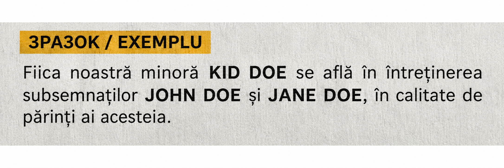

import { Steps } from '@astrojs/starlight/components';
import Summary from '../../../components/Summary.astro';
import PrintMemo from '../../../components/PrintMemo.astro';

	<Fragment slot="highlight">
		Якщо неповнолітня дитина з України має тимчасовий захист у Румунії та живе з батьком або матір’ю з чинною робочою посвідкою, подавайте на сімейну посвідку дитини напряму в IGI (міграційну службу). Почніть зі свідоцтва про народження та його перекладу. Окреме погодження для візи D/VF не потрібне.
	</Fragment>

## Кроки

<Steps>

1. **[Зберіть документи](#документи).** Підготуйте переклад свідоцтва про народження, декларацію батьків, документи на житло, дохід і здоров’я дитини. Сплатіть два збори.

2. **[Подайте заяву в IGI](#подача-в-igi).** У своєму акаунті Portal IGI створіть профіль дитини. Оберіть продовження права проживання за сімейною підставою, запишіться і прийдіть з дитиною та оригіналами.

3. **[Заберіть посвідку](#отримання-посвідки).** Дочекайтеся рішення та видачі картки в тому самому відділенні IGI.

</Steps>

## Документи

Батько або мати з робочою посвідкою є спонсором. Для дитини підготуйте документи за пунктом **6. Membrii de familie ai sponsorului** (члени сім’ї спонсора) в [переліку IGI](https://igi.mai.gov.ro/permis-de-sedere/).

- **Свідоцтво про народження (*certificat de naștere*).** Візьміть український оригінал і копію. Замовте переклад румунською в авторизованого перекладача та нотаріальне засвідчення перекладу (*traducere legalizată*). Для українського свідоцтва ДРАЦС діє [двостороннє звільнення від апостиля](https://econsulat.ro/ApostilareSupralegalizare/DescriereServiciu/600000004).
- **Документ на житло (*dovada deținerii legale a spațiului de locuit*).** Підготуйте оригінал і копію договору оренди або документа про право власності на житло, де дитина живе зі спонсором. Якщо орендуєте у фізособи, візьміть договір, зареєстрований у податковій. [Інші документи, які приймає IGI](https://igi.mai.gov.ro/wp-content/uploads/2021/10/dovada-spatiu-locuit-terti.pdf).
- **Підтвердження коштів на утримання (*dovada mijloacelor de întreținere*).** Попросіть у роботодавця спонсора довідку про зарплату (*adeverință de salariu*). Підійде також [виписка з банку або інший документ із переліку IGI](https://igi.mai.gov.ro/wp-content/uploads/2021/10/dovada-mijloacelor-de-intretinere-sponsor.pdf). Підтвердьте щонайменше одну мінімальну зарплату брутто на місяць на запитуваний період. Якщо робочу посвідку спонсора видали більш ніж на рік, підтвердьте кошти щонайменше за 12 місяців.
- **Страхування дитини (*dovada asigurării sociale de sănătate*).** Візьміть довідку про страхування (*adeverință de asigurat*) у [касі медичного страхування свого жудця (CAS)](https://cnas.ro/case-judetene/). Для першої посвідки IGI також приймає [поліс, що покриває ті самі ризики, що й державне страхування громадян Румунії](https://igi.mai.gov.ro/wp-content/uploads/2021/10/dovada-asigurarii-sociale-prima-prelungire.pdf). Оформлюйте поліс на дитину.
- **Медична довідка (*adeverință medicală*).** Попросіть сімейного лікаря або клініку видати довідку для IGI на ім’я дитини. У довідці має бути зазначено, що дитина не має хвороб, які можуть загрожувати громадському здоров’ю.

### Декларація батьків

У письмовій декларації (*declarația sponsorului*) спонсор указує ім’я дитини й адресу, за якою вони живуть разом. У прикладі нижче батьки також зазначили, що утримують дитину. Довідку про зарплату або виписку з банку додайте окремо.

:::note[Спільна опіка]
Якщо опіка спільна, оформіть у нотаріуса згоду другого з батьків (*consimțământ*). Укажіть, що він або вона погоджується на проживання дитини зі спонсором у Румунії за вказаною адресою та на оформлення посвідки. Згоду можна включити до спільної нотаріальної декларації.
:::

### Оплата

У касі CEC Bank сплатіть **265 леїв за картку** (*contravaloarea permisului de ședere*) і **120 євро в леях за розгляд заяви** (*taxa de prelungire a dreptului de ședere*). Для другого платежу каса перерахує суму в леї за курсом дня. Візьміть паспорт дитини: для збору за розгляд заяви потрібен його номер. Оформіть платежі на ім’я дитини та збережіть обидві квитанції.

## Подача в IGI

### Запис на прийом

<Steps>

1. **Створіть профіль дитини в [Portal IGI](https://portaligi.mai.gov.ro/portaligi/).** Увійдіть в акаунт одного з батьків. Відкрийте **Profiluri → Adaugă profil**. Введіть дані дитини з паспорта, її адресу в Румунії та електронну пошту для підтвердження профілю. Перейдіть за посиланням у листі.

2. **Виберіть послугу.** Відкрийте **Solicitări online → Adaugă solicitare**. Виберіть підтверджений профіль дитини й натисніть **Selectează**. Оберіть **Prelungirea dreptului de ședere temporară pentru reîntregirea familiei, inclusiv membrii de familie cetățeni români** (продовження права проживання за сімейною підставою). Натисніть **Adaugă solicitare**. Цю послугу використовуйте і для першої картки дитини.

   :::note[Погодження для візи]
   Окрема послуга **Admisie pentru reîntregirea familiei / Family reunification** потрібна для погодження перед консульською візою D/VF. За ст. 82 ч. (1) п. a) та ч. (5) неповнолітня дитина може податися в Румунії без такої візи, якщо один із батьків має румунське право проживання.
   :::

3. **Заповніть заяву й виберіть час.** Оберіть відділення IGI за адресою дитини, дату й час. Звірте її адресу та паспортні дані. Поле **Date permis ședere** призначене для попередньої посвідки й не обов’язкове. Якщо є поле для опису підстави, напишіть *Reîntregirea familiei – copil minor al unui titular de permis de ședere în scop de muncă, art. 82 alin. (1) lit. a) și alin. (5)*. Завантажте скани за чек-лістом у **Fișiere atașate** і натисніть **Salvează**. Підтвердьте запис у строк, зазначений у повідомленні від порталу, і збережіть підтвердження.

   :::caution[Портал вимагає візу]
   Якщо правильна послуга блокує подачу без номера D/VF або погодження, підготуйте [паперову заяву](#паперова-заява) для реєстрації у відділенні.
   :::

4. **Прийдіть до IGI з дитиною.** Покажіть підтвердження запису. Принесіть оригінали й копії, зокрема паспорт дитини та документ про її тимчасовий захист. За досвідом подачі в Клужі, дитину фотографують на прийомі. Після реєстрації заяви збережіть її номер.

</Steps>

### Паперова заява

Для подачі у відділенні завантажте [бланк заяви IGI](https://igi.mai.gov.ro/wp-content/uploads/2022/11/Cerere_prel_sedere_reintregire.pdf). Заповніть великими літерами: у **Subsemnatul** — дані дитини, у **Numele și prenumele părinților** — імена обох батьків, у **Date despre cetățeanul român/sponsor** — дані батька або матері з робочою посвідкою. Верхній службовий блок залиште порожнім.

Зверніться до [відділення IGI свого жудця](https://igi.mai.gov.ro/contact/) для реєстрації заяви з документами за чек-лістом. У відділенні скажіть: *Vreau să depun cererea pentru permisul de ședere al copilului minor pentru reîntregirea familiei, fără viză D/VF, în baza art. 82 alin. (1) lit. a) și alin. (5).*

### Чек-ліст

- [ ] **Заява за сімейною підставою** - *cerere de prelungire a dreptului de ședere pentru reîntregirea familiei*, у порталі або на папері для особистої реєстрації.
- [ ] **Закордонний паспорт дитини** - оригінал і копія.
- [ ] **Документ дитини про тимчасовий захист** - *permis de ședere pentru beneficiarii protecției temporare*, оригінал і копія.
- [ ] **Робоча посвідка спонсора** - *permis de ședere*, оригінал і копія.
- [ ] **Свідоцтво про народження дитини** - *certificat de naștere*, оригінал, копія і нотаріально засвідчений переклад румунською.
- [ ] **Декларація про спільне проживання** - *declarația sponsorului*.
- [ ] **Нотаріальна згода другого з батьків** - *consimțământ*, за спільної опіки.
- [ ] **Документ на житло** - *dovada spațiului de locuit*, оригінал і копія. Договір оренди у фізособи має бути зареєстрований у податковій.
- [ ] **Підтвердження коштів на утримання** - *dovada mijloacelor de întreținere*.
- [ ] **Підтвердження страхування дитини** - *adeverință de asigurat* або поліс для першої посвідки.
- [ ] **Медична довідка дитини** - *adeverință medicală*.
- [ ] **Дві квитанції** - за картку та за розгляд заяви.
- [ ] **Підтвердження запису** - з порталу або пошти.

## Отримання посвідки

Стежте за статусом заяви в порталі та за поштою. IGI розглядає заяву протягом 30 днів від подачі. На додаткові перевірки може піти ще до 15 днів. Якщо IGI запитує документи, надішліть їх у вказаний строк: до їх отримання відлік зупиняється.

Коли картка буде готова, заберіть її в тому самому [відділенні IGI](https://igi.mai.gov.ro/contact/). На сторінці відділення знайдіть години видачі (*eliberări documente*). Строк сімейної посвідки прив’язаний до права проживання спонсора.

У Клужі родина зі спільноти отримала картку дитини без візи D/VF. Родина спочатку записалася через *admisie*, але на прийомі інспектор оформив заяву саме на посвідку.

### Чек-ліст

- [ ] **Закордонний паспорт дитини** - для видачі картки.
- [ ] **Номер заяви** - для перевірки готовності.
- [ ] **Дані на картці** - перевірте ім’я, дату народження, адресу і строк дії. Про помилку повідомте працівнику IGI.

<PrintMemo>

**1. Документи**

- [ ] Українське свідоцтво про народження: оригінал, копія і нотаріально засвідчений переклад румунською.
- [ ] Декларація спонсора про спільне проживання. За спільної опіки — нотаріальна згода другого з батьків.
- [ ] Документ на житло: оригінал і копія. Договір оренди у фізособи має бути зареєстрований у податковій.
- [ ] Довідка про зарплату спонсора, банківська виписка або інше підтвердження коштів.
- [ ] Довідка про страхування дитини від CAS або поліс для першої посвідки.
- [ ] Медична довідка дитини для IGI.
- [ ] Квитанції CEC Bank: 265 леїв за картку і 120 євро в леях за розгляд заяви. Для другого платежу вкажіть номер паспорта дитини.

**2. Подача в IGI**

У Portal IGI створити й підтвердити профіль дитини. Обрати *Solicitări online → Adaugă solicitare → Prelungirea dreptului de ședere temporară pentru reîntregirea familiei*. Обрати час, додати скани, зберегти заяву і підтвердити запис. Якщо портал блокує подачу без візи, підготувати паперову заяву для реєстрації в IGI за ст. 82 ч. (1) п. a) і ч. (5).

- [ ] Заява і підтвердження запису.
- [ ] Паспорт дитини, документ про тимчасовий захист і посвідка спонсора: оригінали й копії.
- [ ] Документи й квитанції з першого кроку. Прийти з дитиною.
- [ ] Номер зареєстрованої заяви.

**3. Отримання посвідки**

- [ ] Дочекатися готовності картки. Взяти паспорт дитини та номер заяви.
- [ ] Забрати картку в години видачі (*eliberări documente*). Перевірити ім’я, дату народження, адресу і строк дії.

</PrintMemo>

## Джерела

- [OUG 194/2002, статті 46, 51, 62 та 82](https://legislatie.just.ro/Public/DetaliiDocument/93712)
- [IGI — посвідка на проживання, пункт 6 Membrii de familie ai sponsorului](https://igi.mai.gov.ro/permis-de-sedere/)
- [Portal IGI — створення профілю та подання заяви](https://portaligi.mai.gov.ro/portaligi/assets/help/manual.html)
- [Portal IGI — назви послуг та відеоінструкції](https://portaligi.mai.gov.ro/portaligi/informatii/tutoriale)
- [IGI — підтвердження запису в порталі](https://igi.mai.gov.ro/%F0%9F%93%A2-informare-modificari-importante-in-portalul-pentru-solicitari-online/)
- [IGI — погодження возз’єднання для візи D/VF](https://igi.mai.gov.ro/aprobarea-reintregirii-familiei-cu-cetateni-terti/)
- [IGI — підтвердження страхування для першої посвідки](https://igi.mai.gov.ro/wp-content/uploads/2021/10/dovada-asigurarii-sociale-prima-prelungire.pdf)
- [IGI — збори за посвідку](https://igi.mai.gov.ro/wp-content/uploads/2025/08/Taxe.pdf)
- [МВС Румунії — сума в леях і способи оплати](https://hub.mai.gov.ro/serviciu/view?id=31)
- [IGI — дані для платежу за розгляд заяви](https://igi.mai.gov.ro/simplificarea-procedurii-de-verificare-a-platii-taxelor-pentru-serviciile-oferite-de-inspectoratul-general-pentru-imigrari/)
- [eConsulat — звільнення українських документів від апостиля](https://econsulat.ro/ApostilareSupralegalizare/DescriereServiciu/600000004)
- [Договір між Румунією та Україною про правову допомогу, стаття 13](https://legislatie.just.ro/Public/DetaliiDocumentAfis/59642)
- [Обговорення в Telegram: досвід подачі без візи D/VF](https://t.me/romaniaitcommunity/11/1075391)
- [Матеріали спільноти: приклад декларації](https://github.com/artemmanaenko/nadili_ro/pull/15)
