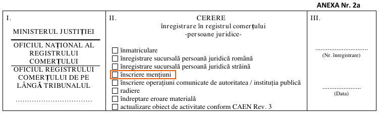
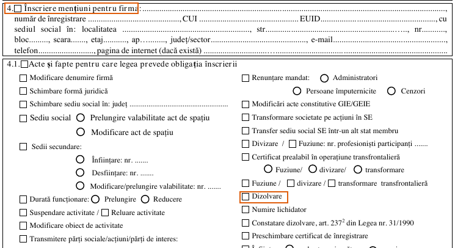
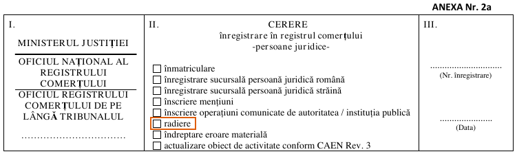
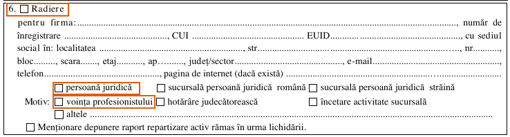

import { Steps, TabItem, Tabs } from '@astrojs/starlight/components';
import Summary from '../../../components/Summary.astro';
import PrintMemo from '../../../components/PrintMemo.astro';

	<Fragment slot="highlight">
		SRL можна закрити без призначення ліквідатора, якщо учасники погодили порядок ліквідації та розподіл залишку майна, а борги погашено або врегульовано за згодою кредиторів.
	</Fragment>

## Кроки

<Steps>

1. **[Подайте рішення про ліквідацію](#подання-рішення).**
2. **[Знайдіть дату публікації](#публікація-рішення).**
3. **[Підготуйте ліквідаційну звітність](#ліквідаційна-звітність).** Для неї діє окремий строк від дати затвердження.
4. **[Отримайте свідоцтво про виключення SRL](#виключення-з-реєстру).**

</Steps>

## Подання рішення

ONRC — торговий реєстр Румунії, ORCT — його відділення. Послуга має назву *dizolvare și lichidare simultană*.

:::note[Якщо немає згоди]
Якщо учасники не погодили розподіл залишку майна, скористайтеся [процедурою з призначенням ліквідатора](https://www.onrc.ro/index.php/ro/dizolvari-lichidari-radieri/persoane-juridice/dizolvarea-voluntara-si-lichidarea-cu-numire-de-lichidator).
:::

### Рішення учасників

Відкрийте [зразок ONRC (RTF)](https://www.onrc.ro/templates/site/formulare/modele%20asistenta/hotarare_aga_decizie_asoc_unic_art_235%20cod%20013.rtf) і виберіть тип рішення.

- **Один учасник.** Рішення єдиного учасника (*decizia asociatului unic*).
- **Кілька учасників.** Рішення загальних зборів (*hotărârea adunării generale a asociaților*).

У рішенні зафіксуйте три пункти.

- **Розпуск і ліквідацію** в межах однієї процедури.
- **Борги.** Зазначте, як їх погасили або врегулювали за згодою кредиторів.
- **Залишок майна.** Запишіть, як його розподілять. Розподіл мають погодити всі учасники.

Якщо в компанії немає активів і зобов’язань, залиште в зразку варіант *societatea nu are active sau pasive*.

**Якщо є бухгалтер,** надішліть йому останні виписки й непогашені рахунки. Попросіть звірити борги й визначити залишок майна після розрахунків.

### Перша заява

Заяву може підписати будь-який учасник SRL, законний представник компанії, уповноважена особа або адвокат.

<Steps>

1. **Відкрийте [форму 2a (PDF)](https://www.onrc.ro/templates/site/formulare/11-10-150.pdf).** Позначте поля в помаранчевих рамках і внесіть дані заявника в розділ IV.

   

2. **Заповніть дані SRL у розділі V.4.** Перенесіть їх із реєстраційних документів компанії.

   

3. **Заповніть розділи VI–VIII.**
   - **VI** — виберіть один спосіб отримання відповіді.
   - **VII** — вкажіть дані одержувача.
   - **VIII** — перелічіть додатки.
4. **Підпишіть форму.** Підпишіть підтвердження про обробку персональних даних. Унизу поставте дату й підпис.

</Steps>

### Канал подання

Для подання електронною поштою потрібен кваліфікований електронний підпис. Якщо підпису немає, подайте паперову заяву у відділенні.

<Tabs>
<TabItem label="У відділенні">

Підпишіть заяву від руки. Подайте її з додатками у [відділенні ONRC](https://www.onrc.ro/index.php/ro/retea-onrc) та збережіть номер справи.

</TabItem>
<TabItem label="Електронною поштою">

1. **Знайдіть адресу для заяв.** У [переліку відділень ONRC](https://www.onrc.ro/index.php/ro/retea-onrc) відкрийте жудець за юридичною адресою SRL. Шукайте рядок *Pentru transmiterea […] cererilor de înregistrare*.
2. **Надішліть підписану заяву з додатками.** Додайте електронні оригінали або копії, засвідчені кваліфікованим підписом.
3. **Збережіть номер справи.**

</TabItem>
</Tabs>

### Оплата публікації

ONRC видає розрахунок (*nota de calcul*) після схвалення заяви (*ADMIS*).

- **Сума.** [152 леї за сторінку](https://legislatie.just.ro/Public/FormaPrintabila/00000G1YBLWRRMA0B9E0U5S2ERJE3MF4) публікації в офіційному віснику *Monitorul Oficial*. Точна сума в розрахунку.
- **Строк.** [Сплатіть до видачі документів](https://www.onrc.ro/index.php/ro/?id=87).

<Tabs>
<TabItem label="Портал ONRC">

1. **Увійдіть на [портал ONRC](https://myportal.onrc.ro/).** Відкрийте **Spațiul virtual → Notele mele de calcul**.
2. **Знайдіть розрахунок за описом вашої заяви.** Якщо він є в списку, звірте суму й оплатіть у цьому розділі. Якщо розрахунку немає, відкрийте вкладку **Інші способи**.
3. **Перевірте статус платежу** в тому самому розділі після оплати.

</TabItem>
<TabItem label="Інші способи">

- **Банківський переказ.** Знайдіть IBAN та CUI відділення, яке видало розрахунок, у [переліку рахунків ONRC](https://www.onrc.ro/index.php/ro/conturi-iban). Перекажіть суму з розрахунку.
- **Термінал або поштовий переказ.** Сплатіть у терміналі самообслуговування у відділенні або поштовим переказом.

Збережіть підтвердження оплати.

</TabItem>
</Tabs>

### Чек-ліст

- [ ] **Заява про внесення змін** - форма 2a, *înscriere mențiuni*.
- [ ] **Рішення одноосібного учасника або зборів** - *decizia asociatului unic* або *hotărârea adunării generale a asociaților*.
- [ ] **Згода кредиторів** (*acordul creditorilor*) - якщо борги врегульовуєте за домовленістю.
- [ ] **Спеціальні дозволи** - якщо закон вимагає їх для ліквідації SRL.
- [ ] **Підтвердження повноважень** - якщо подає представник за дорученням.

## Публікація рішення

1. **Відкрийте пошук публікацій.** На [сайті Monitorul Oficial](https://monitoruloficial.ro/produs/exemplare-pretiparite-partea-a-iii-a-si-partea-a-iv-a/) перейдіть до *expert-monitor* і виберіть *Partea IV-a*.
2. **Знайдіть свій випуск.**
   - **Nume societate** — назва компанії без SC і SRL.
   - **An publicație** — рік публікації.
   - Натисніть **Caută** й збережіть номер і дату випуску.
3. **Відлічіть 30 днів від дати публікації.** Подавайте другу заяву після спливу цього строку. ONRC підтверджує публікацію самостійно.

## Ліквідаційна звітність

### Звіт до ANAF

1. **Підготуйте ліквідаційну фінансову звітність.** Бланк і вимоги до пакета є на сторінці [форми S1039](https://static.anaf.ro/static/10/Anaf/Declaratii_R/situatiifinanciare/2025/1039_2025.html).
2. **Подайте звітність до ANAF (румунської податкової).** Для спеціальної ліквідаційної звітності є [30 днів від затвердження](https://legislatie.just.ro/public/DetaliiDocument/171605).
3. **Збережіть квитанцію про прийняття.**

Якщо у вас є бухгалтер, передайте йому рішення про ліквідацію, виписки й документи про остаточні розрахунки. Попросіть підготувати звітність, визначити останні декларації й платежі за податковим режимом SRL та передати вам квитанції.

| Податковий режим SRL | Що зробити до дати подання ліквідаційної фінзвітності |
| --- | --- |
| Податок на прибуток | Подайте річну декларацію і сплатіть податок. |
| Мікропідприємство, ліквідацію завершено в тому самому році | Задекларуйте і сплатіть податок мікропідприємства. |

Строки встановлюють ст. 41(16) і 56(3) [Податкового кодексу](https://static.anaf.ro/static/10/Anaf/legislatie/Cod_fiscal_norme.htm).

### Податок учасника

SRL виконує ці дії, якщо учасник-фізособа є податковим резидентом Румунії й отримує оподатковуваний дохід від ліквідації.

- **Утримайте 10%** з оподатковуваного доходу.
- **Задекларуйте податок.** У [формі D100](https://static.anaf.ro/static/10/Anaf/Declaratii_R/100.html) виберіть [позицію 8 *Impozit pe veniturile din lichidarea unei persoane juridice*](https://static.anaf.ro/static/10/Anaf/AsistentaContribuabili_r/NomBugetStat.htm).
- **Сплатіть податок.** Строк за ст. 97(5) Податкового кодексу прив’язаний до подання остаточної фінансової звітності до торгового реєстру.
- **Збережіть документи.** Розрахунок податку, квитанцію про прийняття D100 і підтвердження платежу.

ONRC вимагає підтвердження розрахунку, утримання та сплати податку. У відкритій інструкції ONRC не названо конкретних підтвердних документів.

## Виключення з реєстру

:::caution[Нульовий дохід]
Для випадку без оподатковуваного доходу від ліквідації пакет документів для другої заяви поки не підтверджено. Інструкція ONRC не уточнює, чим підтвердити відсутність такого доходу.
:::

### Друга заява

1. **Заповніть нову [форму 2a (PDF)](https://www.onrc.ro/templates/site/formulare/11-10-150.pdf).** У розділі IV внесіть дані того, хто підписує цю заяву. Заповніть розділи VI–VIII та підпишіть форму [так само, як першу заяву](#перша-заява).

   

2. **Заповніть розділ V.6.** Внесіть дані SRL і вкажіть, що юридична особа припиняє діяльність за власним рішенням.

   

3. **Подайте підписану заяву з додатками** [у відділенні або електронною поштою](#канал-подання).
4. **Збережіть свідоцтво про виключення (*certificat de radiere*) й рішення реєстратора (*încheiere*).** Отримайте їх способом, обраним у заяві. Рішення також публікують у BERC, [електронному бюлетені торгового реєстру](https://myportal.onrc.ro/).

### Чек-ліст

- [ ] **Заява про виключення з реєстру** - нова форма 2a, *radiere*, розділ V.6.
- [ ] **Підтвердження розрахунку, утримання й сплати податку з ліквідаційного доходу** - якщо був оподатковуваний дохід. Див. [податок учасника](#податок-учасника).
- [ ] **Підтвердження повноважень** - якщо подає представник за дорученням.

<PrintMemo>

**1. Подайте рішення до ONRC**

- [ ] Заява 2a: II *înscriere mențiuni*, V.4, 4.1 *Dizolvare*, спосіб отримання й дані одержувача, дата та підпис.
- [ ] Рішення одноосібного учасника або зборів про одночасний розпуск і ліквідацію.
- [ ] Згода кредиторів, якщо борги врегульовуєте за домовленістю.
- [ ] Спеціальні дозволи, якщо закон вимагає їх для ліквідації SRL.
- [ ] Підтвердження повноважень, якщо подає представник за дорученням.

Подайте у відділенні ONRC або на його адресу для заяв. Для подання електронною поштою потрібен кваліфікований електронний підпис. Збережіть номер справи.

Після схвалення (*ADMIS*) оплатіть публікацію за розрахунком ONRC (*nota de calcul*) до видачі документів (152 леї за сторінку). Якщо розрахунок є на порталі, відкрийте *Spațiul virtual → Notele mele de calcul*, сплатіть і перевірте статус. Інші способи: термінал у відділенні, поштовий або банківський переказ. Збережіть підтвердження.

**2. Знайдіть публікацію**

Monitorul Oficial: *expert-monitor → Partea IV-a → Nume societate* без SC і SRL → *An publicație → Caută*. Запишіть номер і дату випуску. Другу заяву подавайте після спливу 30 днів від публікації.

**3. Підготуйте звітність для ANAF**

Подайте спеціальну ліквідаційну звітність S1039 протягом 30 днів від її затвердження. Збережіть квитанцію. Звірте останні декларації та сплату податків SRL за її податковим режимом.

**4. Подайте заяву на виключення**

- [ ] Нова заява 2a: II *radiere*, V.6 *Radiere*, *persoană juridică*, *voința profesionistului*, спосіб отримання й дані одержувача, дата та підпис.
- [ ] Підтвердження розрахунку, утримання й сплати податку, якщо був оподатковуваний дохід від ліквідації.
- [ ] Підтвердження повноважень, якщо подає представник за дорученням.

За нульового оподатковуваного доходу пакет для другої заяви поки не підтверджено.

Подайте у відділенні або електронною поштою з кваліфікованим підписом. Збережіть свідоцтво про виключення з реєстру (*certificat de radiere*) і рішення реєстратора.

</PrintMemo>

## Джерела

- [ONRC. Одночасний розпуск і ліквідація SRL](https://www.onrc.ro/index.php/ro/dizolvari-lichidari-radieri/persoane-juridice/dizolvarea-si-lichidarea-simultana-a-snc-scs-srl-si-gie)
- [ONRC. Оплата публікації після схвалення заяви](https://www.onrc.ro/index.php/ro/?id=87)
- [Портал ONRC. Довідка про Notele mele de calcul](https://myportal.onrc.ro/guide)
- [Парламент Румунії. Тарифи публікації в Monitorul Oficial](https://legislatie.just.ro/Public/FormaPrintabila/00000G1YBLWRRMA0B9E0U5S2ERJE3MF4)
- [ONRC. Рахунки відділень для оплати](https://www.onrc.ro/index.php/ro/conturi-iban)
- [ONRC. Строк подання заяви на виключення з реєстру](https://www.onrc.ro/index.php/ro/dizolvari-lichidari-radieri/persoane-juridice/dizolvarea-si-lichidarea-simultana-a-snc-scs-srl-si-gie?id=201)
- [Закон № 31/1990 про компанії, ст. 235](https://legislatie.just.ro/Public/FormaPrintabila/00000G35CWYLPE1S0HD2Z8C428BBB8BR)
- [Закон № 265/2022 про торговий реєстр, ст. 25–26](https://legislatie.just.ro/Public/DetaliiDocument/288036)
- [ONRC. Форма заяви 2a (PDF)](https://www.onrc.ro/templates/site/formulare/11-10-150.pdf)
- [ONRC. Зразок рішення учасників за ст. 235 (RTF)](https://www.onrc.ro/templates/site/formulare/modele%20asistenta/hotarare_aga_decizie_asoc_unic_art_235%20cod%20013.rtf)
- [Monitorul Oficial. Пошук випуску частини IV](https://monitoruloficial.ro/produs/exemplare-pretiparite-partea-a-iii-a-si-partea-a-iv-a/)
- [Мінфін Румунії. Строк подання ліквідаційної звітності, п. 5](https://legislatie.just.ro/public/DetaliiDocument/171605)
- [ANAF. Форма фінансової звітності S1039](https://static.anaf.ro/static/10/Anaf/Declaratii_R/situatiifinanciare/2025/1039_2025.html)
- [ANAF. Бланк і інструкція D100](https://static.anaf.ro/static/10/Anaf/Declaratii_R/100.html)
- [ANAF. Номенклатор платежів, позиція 8](https://static.anaf.ro/static/10/Anaf/AsistentaContribuabili_r/NomBugetStat.htm)
- [ANAF. Податковий кодекс, ст. 41, 56, 97](https://static.anaf.ro/static/10/Anaf/legislatie/Cod_fiscal_norme.htm)
