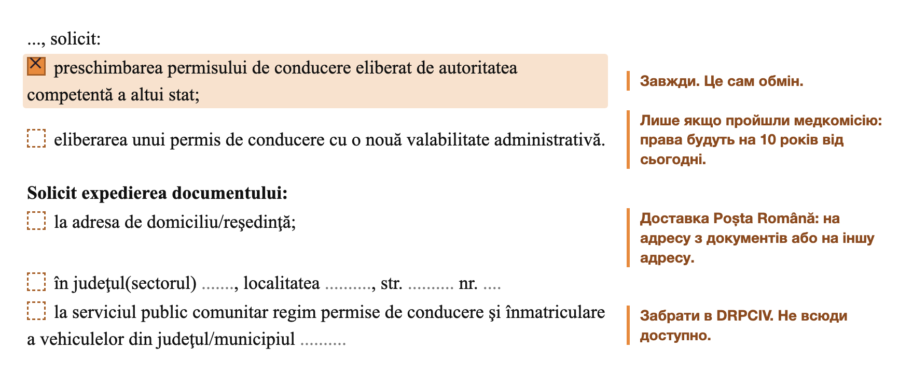
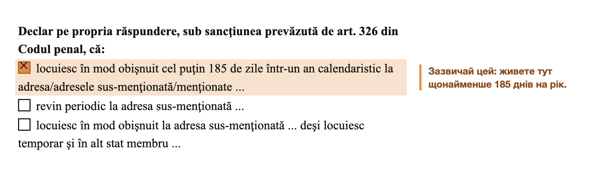

import { Steps, TabItem, Tabs } from '@astrojs/starlight/components';
import Summary from '../../../components/Summary.astro';
import PrintMemo from '../../../components/PrintMemo.astro';
export const fullExample = `${import.meta.env.BASE_URL.replace(/\/$/, '')}/examples/exchange-driving-licence-form.png`;

	<Fragment slot="highlight">
		На час обміну - **тимчасові права** (Dovada preschimbare permis): лише Румунія, продовжувати кожні 30 днів.
	</Fragment>

	Обмін можна зупинити будь-коли й забрати українські права.

## Кроки

<Steps>

1. **[Медкомісія](#медкомісія)** - перевірте умови перед записом.

2. **[DRPCIV («МРЕО»)](#drpciv-мрео)** - подача документів, того ж дня тимчасові права.

3. **[Посольство України](#посольство-україни)** - підтвердження українських прав.

4. **Чекайте 2-3 місяці**, потім ще 1-2 тижні на друк і доставку.

</Steps>

## Медкомісія

:::note[Чи потрібна]
- **Права видані понад 10 років тому** - потрібна, за досвідом спільноти.
- **Права ще дійсні й видані менше 10 років тому** - за досвідом спільноти, можна обміняти без медкомісії. Для категорії B строк румунських прав обмежений 10 роками від дати видачі українських.
- **Хочете нові 10 років для категорії B** - потрібна медкомісія.

Наприклад, українські права категорії B видані 1 січня 2020 року на 50 років. При обміні у 2026 році **без медкомісії румунські права діятимуть до 1 січня 2030 року**, з медкомісією - 10 років від обміну.
:::

### Як пройти

<Steps>

1. **Сімейний лікар (medic de familie).** Попросіть *adeverință de boli cronice* для медкомісії на водійські права. У довідці лікар зазначає, чи є у вас хронічні захворювання за медичною карткою, і перелічує їх, якщо вони є.

2. **Клініка.** Оберіть [групу](#яка-група-grupa) й [клініку](#де-зробити). Прийдіть з усім із чек-ліста.

3. **Довідка з медкомісії (fișă medicală)** - видають у день огляду, діє приблизно рік.

</Steps>

### Яка група (grupa)

| | Grupa 1 | Grupa 2 |
| --- | --- | --- |
| **Категорії** | A, B, BE (AM, A1, A2, B1) | C, CE, D, DE (C1, C1E, D1, D1E) |
| **Кому** | усі ваші категорії з Grupa 1, напр. лише B | хоч одна категорія з Grupa 2, напр. B і C |
| **Ціна** | ~250 лей | ~350 лей |

### Чек-ліст

- [ ] **Документ, що посвідчує особу**
- [ ] **Довідка про хронічні захворювання** - *adeverință de boli cronice* від сімейного лікаря.
- [ ] **Окуляри або лінзи** - якщо носите.

### Де зробити

Приклади, не реклама. Актуальні ціни на сайтах.

| Клініка | Ціна | Як потрапити |
| --- | --- | --- |
| [MedExpert](https://clinicamedexpert.ro/fisa-medicala-pentru-auto-si-moto/) | **Grupa 1**: 250 лей **Grupa 2**: 350 лей | запис: телефон або WhatsApp; Grupa 2 не щодня |
| [Rimmed](https://www.rimmed.ro/) | 250 лей (за досвідом) | без запису, пн-пт 08:30-17:00, ~30 хв |

## DRPCIV («МРЕО»)

_За досвідом спільноти, з нещодавно виданим тимчасовим захистом іноді не приймали документи._

:::danger[Копія прав]
До подачі зробіть копію або скан українських прав: оригінал заберуть, а копія потрібна в посольстві.
:::

### Чек-ліст

- [ ] **Тимчасовий захист або посвідка на проживання** - з адресою в Румунії.
- [ ] **Паспорт**
- [ ] **Українські права** - оригінал.
- [ ] **Нотаріальний переклад прав румунською** (traducere legalizată) - бюро перекладів + нотаріус, зазвичай 1-2 робочі дні. Потрібен оригінал прав.
- [ ] **Довідка з медкомісії (fișă medicală)** - якщо проходили, не старша за рік.
- [ ] **Заповнена заява** - див. [Заява](#заява).
- [ ] **Підтвердження оплати 139 лей** - див. [Оплата](#оплата).

### Заява

[Бланк заяви DGPCI (.docx)](https://dgpci.mai.gov.ro/assets/uploads/documente-formulare/1c856a60-b0a6-11ef-ba1f-a7a7629aaa05.docx).

На картинках: помаранчеве відмічають усі, пунктир - за ситуацією.

<a class="example-link" href={fullExample} target="_blank" rel="noopener">
	
	<strong>Повний приклад заповненої заяви</strong> Відкриється в новій вкладці. Персональні дані замінено.
</a>

<Steps>

1. **Шапка:** ім'я, адреса з захисту або посвідки, документ (серія, номер, ким виданий), CNP.

2. **Що просите і доставка.**

   

   Права дійсні до 2028 року, обмін без медкомісії: галочку про новий термін не ставите, румунські права будуть до 2028-го.

3. **Розділ I, проживання.**

   

4. **Розділи II і IV** - відмітьте обидва. Розділ III пропустіть.

5. **Дата й підпис.** Фото не клейте, сфотографують на місці.

</Steps>

### Оплата

139 лей (contravaloarea permisului de conducere). Платите до візиту, підтвердження берете з собою.

<Tabs>
<TabItem label="Онлайн, ghiseul.ro">

<Steps>

1. Відкрийте **[форму оплати на ghiseul.ro](https://www.ghiseul.ro/ghiseul/public/taxe/taxe-speciale/id/eyJpZEluc3QiOiA3MjExLCAidGlwUGVycyI6MCwgInZhbGlkYXJpIjogImZhbHNlIiwgInRpdGx1IjogIlBlcm1pc2UgYXV0by8gQ2VydGlmaWNhdGUgZGUgw65ubWF0cmljdWxhcmUvIEF1dG9yaXphyJtpZSBwcm92aXpvcmllIn0%3D)**. Без реєстрації.

2. Вкажіть CNP, ім'я, **permis de conducere**, 139 лей, email.

3. Оплатіть карткою.

4. Збережіть підтвердження з email: DRPCIV його вимагає.

</Steps>

:::caution
Перевірте email: підтвердження прийде лише туди.
:::

</TabItem>
<TabItem label="Термінал SelfPay">

- У супермаркетах, ТЦ, біля DRPCIV (там буває черга або не працює).
- Готівка або картка, потрібен CNP.
- Збережіть чек.

</TabItem>
<TabItem label="Банк">

| Реквізит | Значення |
| --- | --- |
| **Отримувач** | RA-APPS |
| **IBAN** | `RO94RNCB0082000367331018` (BCR) |
| **Сума** | 139 лей |
| **Призначення** | CNP, прізвище та ім'я, `contravaloare permis de conducere` |

- **Переказ, internet banking:** зараховується від 24 годин, платіть за день до візиту.
- **Готівкою:** BCR, CEC Bank, mandat poștal.
- **Автомат CEC Bank:** **Taxe înmatriculare**, далі **Permisul de conducere**.

</TabItem>
</Tabs>

### Запис і подача

<Steps>

1. **Запишіться на [сайті запису](https://dgpci.mai.gov.ro/drpciv-booking/).**
   - **Pasul 1:** оберіть жудець, де живете (Bucuresti, Ilfov, Timis...). Для деяких жудеців, наприклад Ilfov, сайт перекине на hub.mai.gov.ro: там оберіть пункт прийому.
   - **Pasul 2:** послуга **Preschimbare permis străin**.
   - **Pasul 3:** Nume, Prenume, CNP, E-mail, потім **AFIȘARE CALENDAR**, оберіть дату й час і натисніть **FINALIZARE PROGRAMARE**.

   Слоти на завтра відкриваються звечора.

2. **Прийдіть у призначений день.** Талон в автоматі, черга, віддаєте все з чек-ліста.

3. **Отримайте тимчасові права (Dovada).** Зробіть копію для посольства.

   :::caution[Dovada діє до 30 днів]
   Якщо пластик ще не готовий, до кінця терміну прийдіть у той самий DRPCIV по нову Dovada.
   :::

</Steps>

## Посольство України

Посольство підтверджує для DRPCIV, що ваші українські права справжні.

**Адреса:** [Bd. Aviatorilor 24, сектор 1, Бухарест](https://www.google.com/maps/search/?api=1&query=Ambasada+Ucrainei+Bulevardul+Aviatorilor+24+Bucuresti). Прийом документів за записом: пн-пт 09:30-12:30 і 14:00-16:30. Консульський відділ: +40 21 230 36 60.

### Чек-ліст

- [ ] **Українські права** - копія.
- [ ] **Паспорт громадянина України і закордонний паспорт** - оригінали й копії.
- [ ] **Тимчасовий захист або посвідка на проживання** - копія.
- [ ] **Копія документа з DRPCIV про обмін прав**
- [ ] **Копія РНОКПП** (ідентифікаційний код)
- [ ] **Витяг з місця проживання** - якщо паспорт ID-картка; замовити в Дії.
- [ ] **Резерв+ з QR-кодом** - чоловікам 18-60, оновити за 72 години до візиту.
- [ ] **Фізична банківська картка** - якщо сплачуватимете в терміналі.

### Запис і подача

<Steps>

1. **Запишіться в [електронну чергу](https://romania.mfa.gov.ua/konsulski-pitannya/gromadianam-ukrainy/elektronna-cherga)** на сайті посольства, опція **«Витребування документа»**.

2. **Прийдіть у призначений день** з усім із чек-ліста. Сплатіть збір 30 доларів фізичною карткою в терміналі або у відділенні банку; банк займе більше часу.

   :::caution[Телефон вимикають]
   На вході попросять вимкнути телефон, тому для оплати в терміналі потрібна фізична картка.
   :::

3. **Чекайте 2-3 місяці.** Посольство передасть відповідь МВС до DRPCIV. Після цього розпочнуть виготовлення прав і надішлють їх поштою, якщо ви обрали доставку.

</Steps>

<PrintMemo>

**Термін:** 2-3 місяці. **Вартість:** 139 лей + переклад, медкомісія за потреби. **На час обміну:** тимчасові права (Dovada), лише Румунія, продовжувати кожні 30 днів.

**1. Медкомісія** - потрібна для прав, виданих понад 10 років тому (за досвідом спільноти), або для нового строку дії. Дійсні права, видані менше 10 років тому, можна обміняти без неї зі збереженням строку. Приклад для категорії B: обмін у 2026-му, права до 2028-го - без медкомісії до 2028-го, з нею до 2036-го.

Grupa 1: A, B, BE. Grupa 2: C, CE, D, DE (є хоч одна - потрібна Grupa 2). Довідка з медкомісії в день огляду, діє приблизно рік.

- [ ] Документ, що посвідчує особу
- [ ] Довідка про хронічні захворювання (*adeverință de boli cronice*) від сімейного лікаря
- [ ] Окуляри або лінзи, якщо носите

**2. DRPCIV («МРЕО»)**

До візиту:

- [ ] **Копія або скан українських прав** - оригінал заберуть, копія для посольства
- [ ] Нотаріальний переклад прав румунською - бюро перекладів + нотаріус, 1-2 робочі дні, потрібен оригінал прав
- [ ] Заява: бланк DGPCI «cerere preschimbare permis de conducere străin». Відмітити: preschimbarea; новий термін - лише після медкомісії; спосіб отримання; розділи I (185 днів), II, IV; дата й підпис
- [ ] Оплата 139 лей: ghiseul.ro (без реєстрації), термінал SelfPay або переказ RA-APPS, IBAN RO94RNCB0082000367331018, призначення: CNP, ім'я, contravaloare permis de conducere (переказ зараховується від 24 год)
- [ ] Запис: dgpci.mai.gov.ro/drpciv-booking - жудець, Preschimbare permis străin, дата. Слоти на завтра відкриваються звечора

Взяти з собою:

- [ ] Тимчасовий захист або посвідка з адресою
- [ ] Паспорт
- [ ] Українські права (оригінал)
- [ ] Нотаріальний переклад
- [ ] Довідка з медкомісії, якщо проходили
- [ ] Заповнена заява
- [ ] Підтвердження оплати

На місці: талон в автоматі, черга. Отримаєте Dovada - зробіть копію для посольства. Dovada діє до 30 днів: якщо пластик не готовий, до кінця терміну прийдіть у той самий DRPCIV по нову.

**3. Посольство України** - Bd. Aviatorilor 24, сектор 1. Запис в електронну чергу на romania.mfa.gov.ua, опція «Витребування документа»; прийом пн-пт 09:30-12:30, 14:00-16:30. Збір 30 доларів: фізичною карткою в терміналі або у відділенні банку, що займе більше часу. На вході попросять вимкнути телефон.

- [ ] Копія українських прав
- [ ] Паспорт і закордонний паспорт - оригінали й копії
- [ ] Копія захисту або посвідки
- [ ] Копія документа з DRPCIV (Dovada)
- [ ] Копія РНОКПП
- [ ] Витяг з місця проживання - якщо паспорт ID-картка; замовити в Дії
- [ ] Резерв+ з QR-кодом - чоловікам 18-60, оновити за 72 години
- [ ] Фізична банківська картка - якщо сплачуватимете в терміналі

**4. Чекайте 2-3 місяці**, потім 1-2 тижні на друк і доставку.

</PrintMemo>

## Джерела

- [МЗС України: оплата консульського збору](https://mfa.gov.ua/consul/forua/faq)
- [Запис у DRPCIV онлайн](https://dgpci.mai.gov.ro/drpciv-booking/)
- [Бланк заяви DGPCI, версія 2024 (.docx)](https://dgpci.mai.gov.ro/assets/uploads/documente-formulare/1c856a60-b0a6-11ef-ba1f-a7a7629aaa05.docx)
- [Приклад заповненої заяви зі спільноти](https://t.me/romaniaitcommunity/11/858694)
- [Посольство України в Румунії: порядок обміну посвідчення водія, 25.02.2026](https://romania.mfa.gov.ua/news/poryadok-ta-perelik-neobhidnih-dokumentiv-dlya-obminu-ukrayinskogo-posvidchennya-vodiya-na-rumunske)
- [Посольство України в Румунії: контакти й графік](https://romania.mfa.gov.ua/)
- [Посольство України в Румунії: електронна черга](https://romania.mfa.gov.ua/konsulski-pitannya/gromadianam-ukrainy/elektronna-cherga)
- [Обговорення в спільноті](https://t.me/romaniaitcommunity/12726/1075701)
- [DGPCI: питання про тарифи й оплату](https://dgpci.mai.gov.ro/faq/taxe)
- [DGPCI: оплата через ghiseul.ro без автентифікації](https://dgpci.mai.gov.ro/news-details/presa/6142f4997d66a112ac8ad92c)
- [ghiseul.ro: форма оплати для прав](https://www.ghiseul.ro/ghiseul/public/taxe/taxe-speciale/id/eyJpZEluc3QiOiA3MjExLCAidGlwUGVycyI6MCwgInZhbGlkYXJpIjogImZhbHNlIiwgInRpdGx1IjogIlBlcm1pc2UgYXV0by8gQ2VydGlmaWNhdGUgZGUgw65ubWF0cmljdWxhcmUvIEF1dG9yaXphyJtpZSBwcm92aXpvcmllIn0%3D)
- [Ordinul MAI 163/2011 про обмін іноземних прав: ст. 6 (медкомісія для нового строку), ст. 7 (Dovada)](https://legislatie.just.ro/public/DetaliiDocument/130805)
- [DGPCI: документи для обміну іноземних прав і медична довідка для нового строку](https://dgpci.mai.gov.ro/document-details/permise/5ab135f3fa4e9422012c2bb1)
- [Нотаріус: легалізація перекладу, процедура й вартість](https://notariatdorobanti.ro/legalizare-acte-notariale-procedura-documente-si-costuri)
- [Ordinul MS 1162/2010, додаток 2, розділ D.2: довідка від сімейного лікаря](https://legislatie.just.ro/public/DetaliiDocument/122023)
- [Medicover: що зазначають у довідці про хронічні захворювання](https://www.medicover.ro/investigatii-si-tratamente/fisa-medicala-auto/)
- [MedExpert: тарифи](https://clinicamedexpert.ro/tarife/)
- [Rimmed: avize medicale](https://www.rimmed.ro/)
- [Medlife: що треба знати про fișa medicală](https://www.medlife.ro/articole-medicale/fisa-medicala-permis-auto-ce-trebuie-sa-stii-despre-ea)

Зібрано 2026-11-12.
