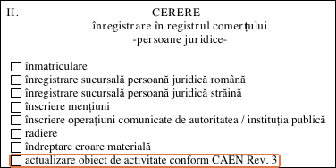
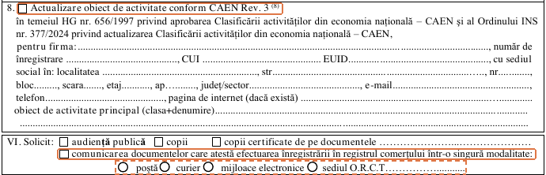

import { Steps, TabItem, Tabs } from '@astrojs/starlight/components';
import Summary from '../../../components/Summary.astro';
import PrintMemo from '../../../components/PrintMemo.astro';

	<Fragment slot="highlight">
		Звірте коди SRL з бухгалтером або самостійно за таблицею відповідності. Якщо коди переходять з Rev. 2 до Rev. 3 без поділу чи об’єднання, а види діяльності в установчому акті залишаються ті самі, подайте заяву на оновлення й отримайте нове свідоцтво.
	</Fragment>

## Кроки

<Steps>

1. **[Звірте коди](#відповідність-кодів).**
2. **[Подайте заяву](#подача-до-onrc).**
3. **[Отримайте свідоцтво](#документи-від-onrc).**

</Steps>

## Відповідність кодів

**Почніть із бухгалтера, якщо він у вас є.** Надішліть йому чинні коди CAEN (румунський аналог КВЕД) з установчого акта (*act constitutiv*). Попросіть список відповідних кодів Rev. 3 з румунськими назвами й уточніть, який код основний та чи є поділ або об’єднання класів.

**Щоб звірити коди самостійно**, відкрийте *Tabel Corespondență CAEN Rev.2 - CAEN Rev.3* на [сайті INS (інституту статистики)](https://insse.ro/cms/ro/caen). Знайдіть старі коди в колонці Rev. 2 і звірте описи відповідників Rev. 3 з видами діяльності в установчому акті. Наприклад, для розробки ПЗ на замовлення **6201 → 6210**.

Якщо кожному старому коду відповідає один окремий новий і види діяльності залишаються ті самі, запишіть основний код Rev. 3 і його назву румунською для пункту V.8.

:::note[Зміна діяльності]
Якщо оновлення передбачає поділ чи об’єднання класів за таблицею або ви змінюєте види діяльності, скористайтеся [процедурою зміни видів діяльності ONRC](https://www.onrc.ro/index.php/ro/mentiuni/persoane-juridice/modificarea-obiectului-de-activitate). У формі 2a позначте V.8 і V.4.1 (*modificare obiect de activitate*).
:::

## Подача до ONRC

### Заява

ONRC — торговий реєстр Румунії. Відкрийте [бланк заяви для юридичних осіб (Anexa nr. 2a, PDF)](https://www.onrc.ro/templates/site/formulare/11-10-150.pdf). Суцільні помаранчеві рамки показують, що позначити всім. Пунктирна рамка виділяє варіанти отримання.

<Steps>

1. **Позначте оновлення CAEN у розділі II.** У розділі IV впишіть свої дані, зокрема дані документа, що посвідчує особу.

   

2. **Заповніть пункт V.8.** Позначте пункт і перенесіть зі свідоцтва та інших документів SRL назву компанії, номер у торговому реєстрі, податковий код (*CUI*), ідентифікатор у реєстрах ЄС (*EUID*) та юридичну адресу. У полі *obiect de activitate principal* впишіть основний код Rev. 3 і його назву румунською.
3. **Виберіть спосіб отримання в розділі VI.** Позначте запит на надсилання або видачу документів. Для електронної подачі позначте *mijloace electronice*. Для подачі у відділенні виберіть один спосіб отримання: електронно (*mijloace electronice*), у відділенні (*sediul O.R.C.T.*), поштою (*poștă*) або кур’єром (*curier*). У розділі VII впишіть дані одержувача. Для електронного отримання вкажіть його електронну адресу.

   

4. **Поставте дату й підпис на останній сторінці.** Для електронної подачі скористайтеся кваліфікованим електронним підписом. Якщо подаєте заяву, яку підписала інша особа, заповніть розділ XII.

</Steps>

Для простого оновлення за пунктом V.8 оновлений установчий акт подавати не потрібно.

### Канал подачі

Скористайтеся електронною поштою, якщо маєте кваліфікований електронний підпис. Для подання у відділенні підпишіть заяву від руки.

<Tabs>
<TabItem label="Електронною поштою">

1. **Знайдіть адресу для подання заяв.** У [переліку відділень ONRC](https://www.onrc.ro/index.php/ro/retea-onrc) оберіть жудець за юридичною адресою SRL і знайдіть електронну адресу в рядку *Pentru transmiterea […] cererilor de înregistrare*.
2. **Надішліть підписану заяву на цю адресу.** Якщо подаєте за дорученням, додайте електронне підтвердження повноважень або його електронну копію, засвідчену кваліфікованим підписом.
3. **Збережіть номер заяви.** Якщо підтвердження не надійшло, зверніться до відділення й запитайте, чи зареєстрували заяву.

</TabItem>
<TabItem label="У відділенні">

1. **Знайдіть територіальне відділення (ORCT)** за юридичною адресою SRL у [переліку відділень ONRC](https://www.onrc.ro/index.php/ro/retea-onrc).
2. **Подайте оригінал підписаної заяви у віконці.** Якщо подаєте за дорученням, додайте оригінал документа про повноваження. Збережіть номер заяви.

</TabItem>
</Tabs>

:::note[Допомога адвоката]
Оновлення кодів можна доручити адвокату. Він може підготувати й подати заяву до ONRC від імені компанії на підставі адвокатського доручення (*împuternicire avocațială*). Якщо у вас є бухгалтер, попросіть порекомендувати адвоката, який оформлює такі зміни.
:::

:::note[Подання через портал]
ONRC також приймає заяви з кваліфікованим електронним підписом через [портал онлайн-послуг](https://myportal.onrc.ro). У лютому 2026 року учасник спільноти радив підготувати PDF посвідки на проживання для подання через портал.
:::

### Чек-ліст

- [ ] **Заява (Anexa nr. 2a)** - оригінал із підписом.
- [ ] **Кваліфікований електронний підпис** - для електронної подачі.
- [ ] **Підтвердження повноважень** (*dovada privind împuternicirea*) - якщо подаєте за дорученням.

## Документи від ONRC

Після реєстрації оновлення отримайте **нове свідоцтво про реєстрацію** (*certificat de înregistrare*) й **актуальні відомості з реєстру** (*informații punctuale la zi*). Якщо подали заяву електронно, ONRC повідомить про результат електронно. Якщо подали у відділенні, отримайте документи способом, який обрали в заяві. Збережіть обидва документи й звірте код у відомостях.

<PrintMemo>

**Оновлення CAEN до Rev. 3 без поділу чи об’єднання кодів і без зміни видів діяльності.**

**ONRC (торговий реєстр)**

- [ ] Звірити коди з бухгалтером або за таблицею відповідності INS. Записати основний код Rev. 3 і його назву румунською.
- [ ] Заповнити Anexa nr. 2a. У розділі II позначити оновлення CAEN, у IV внести свої дані, у V.8 — дані SRL, новий основний код і його назву румунською, у VI обрати спосіб отримання, у VII вказати одержувача та контакти. Поставити дату й підпис. Якщо подаєте заяву, яку підписала інша особа, заповнити XII.
- [ ] Для електронної пошти — підписати заяву кваліфікованим електронним підписом і надіслати у відділення за юридичною адресою SRL. У VI позначити електронне отримання.
- [ ] Для подачі у відділенні — взяти оригінал підписаної заяви в ORCT за юридичною адресою SRL.
- [ ] Якщо подаєте за дорученням — підготувати оригінал підтвердження повноважень або засвідчену електронну копію для подачі онлайн.

Зберегти номер заяви. Після реєстрації отримати нове свідоцтво та актуальні відомості з реєстру обраним способом. Звірити код у відомостях.

</PrintMemo>

## Джерела

- [Постанова уряду Румунії № 788/2026 — перехідний період CAEN Rev. 3 (Monitorul Oficial № 835, с. 10)](https://actadiurna.ro/mof/835-2026.pdf#page=10)
- [ONRC — оновлення кодів CAEN для юридичних осіб](https://www.onrc.ro/index.php/ro/mentiuni/persoane-juridice/actualizarea-obiectului-de-activitate)
- [ONRC — бланк заяви Anexa nr. 2a](https://www.onrc.ro/templates/site/formulare/11-10-150.pdf)
- [INS — класифікатор і таблиця відповідності CAEN Rev. 2 і Rev. 3](https://insse.ro/cms/ro/caen)
- [Торговельна палата Бреїли — інструкція ONRC щодо оновлення й зміни видів діяльності](https://cciabr.ro/procedura-si-formularele-onrc-de-actualizare-a-codurilor-caen-rev-3-pentru-srl-sa-pfa-ii-if-din-anul-2025/)
- [ONRC — зміна видів діяльності](https://www.onrc.ro/index.php/ro/mentiuni/persoane-juridice/modificarea-obiectului-de-activitate)
- [Наказ № 2938/C — заява й документи після оновлення](https://legislatie.just.ro/Public/FormaPrintabila/00000G3PGMHCI50YIUD0EVP0TYXIOPTB)
- [Закон № 265/2022 — представництво, подання й отримання документів](https://www.onrc.ro/documente/Legea%20nr.%20265_2022.pdf)
